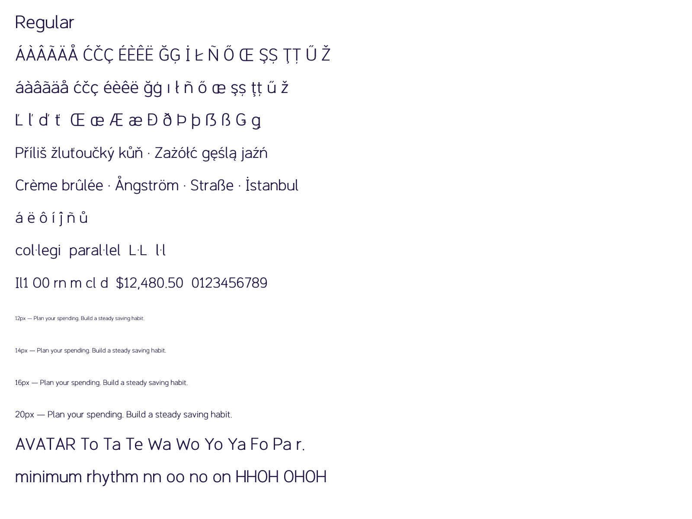

# Direction A — preliminary quality-review candidate

Working family name: **Study A**. Publisher: Nevlin. A permanent family name is pending. This package is a revision of the separately drawn Sprout project following the design-quality rejection of Google Fonts issue #11142; it is not a new independent third origin and is not a fork of Inter.

## What changed

The oval lowercase direction is paired with redrawn D/P/R/U/S and figures 3/5/6/8/9. G and B retain continuous repaired joins. Weight-dependent optical adjustments align flat terminals and rounded baseline overshoots; lowercase ascenders are differentiated from capitals. Ogonek attachment follows the stem/foot of the base. Kerning propagates to accented letters, and mark-to-mark attachment supports stacked accents.

Four static weights: Regular 400, Medium 500, SemiBold 600, Bold 700. Each has 389 encoded characters and 407 glyphs, optional tabular figures and slashed zero, and localized forms. Full pinned Latin Core coverage is verified in all weights.

## Latest validation

FontBakery 1.1.0, network-enabled Google Fonts profile: **613 PASS, 0 FAIL, 0 ERROR, 12 WARN, 239 SKIP, 29 INFO**. The warnings are designer-profile onboarding, serving-subset coverage and unregistered vendor ID, repeated across four fonts. They remain visible and unresolved. All eight binaries matched a clean-environment rebuild. See `qa/summary.json`.

## Rebuild and check

Use Python 3.12 in a fresh virtual environment:

```sh
python3.12 -m venv .venv
.venv/bin/python -m pip install -r requirements.txt
make PYTHON=.venv/bin/python build qa proof
```

Authoritative geometry is in `sources/design.py`, `sources/extended.py` and the optical/mark logic in `sources/build_font.py`. Editable UFOs are regenerated by `make build`; preserve any manual UFO edits separately. Fontmake compiles the UFOs into TTF. WOFF2, per-glyph SVGs, review metadata and an article are generated from the same sources. A GitHub Actions workflow rebuilds and checks this directory.

`qa/shaping.json` exercises accent equivalence, accented kerning, tabular widths, slashed-zero combinations, Catalan forms and stacked marks. `qa/latin-core-coverage.json` identifies the pinned glyphset and every requirement. `qa/fontbakery-network.json` is the full network-enabled check; skips and warnings are not hidden. `qa/reproducibility.json` records repeat-build results. `qa/shaped-*.png` uses HarfBuzz positioning and SVG rendering; Pillow atlas images are for individual glyph inspection, not proof of shaping or OS rasterization.

The existing OFL copyright notice is retained. No reserved font name is declared. The 1.000 binary version is a candidate-format version, not a claim of release approval or independent quality certification. Smart-dropout instructions are included; full grid-fitting/hinting is not claimed.

## Remaining gates

- Independent type-design critique, particularly text colour, optical spacing, complex Latin forms and small-size readability. Automated passes cannot establish that Google's earlier design concerns are resolved.
- Actual browser/OS rendering review. The local-file browser automation was blocked; shaped PNG proofs are available, but a browser pass is not claimed.
- User/Legal confirmation of the final name, copyright owner, OFL/CLA authorization and named ongoing maintainer. The existing notice does not answer these governance questions.
- Google serving-subset guidance, designer-profile onboarding and Microsoft vendor registration. Do not add unsupported script subsets or use another foundry's vendor ID to silence warnings.

No Google issue has been opened or reopened for this revision. This directory is public development work for preliminary review, not an accepted or fully cleared Google Fonts submission.

## Current submission and technical audit

Proposed name **Nevlin Font**, subject to clearance; the binaries still use **Study A**.
See [Google Fonts #11158](https://github.com/google/fonts/issues/11158).
This is distinct from the older Inter-derived family using the same proposed name.



The package now provides `sources/build.sh` as a one-command entry point. See
[the technical audit](documentation/REVIEW-STATUS.md) for the remaining external
checks and why warnings are not suppressed. The Google guide now recommends
Fontspector; the historical FontBakery report remains available for comparison.
