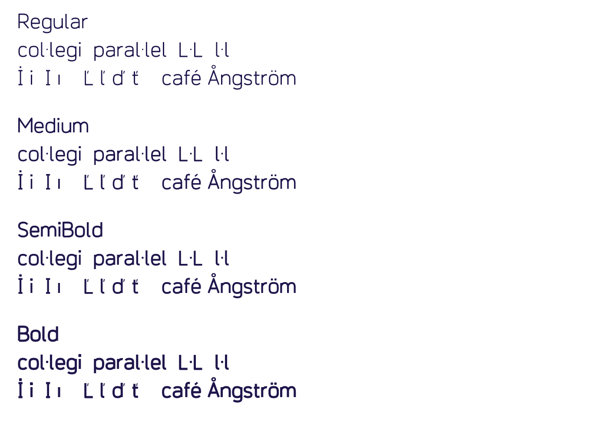

# Nevlin Sprout — 1.001 RC2 review candidate

Original geometric sans-serif family for Nevlin's financial-learning product.
Four static upright weights: Regular 400, Medium 500, SemiBold 600 and Bold 700.
389 encoded characters, 407 glyphs per weight; full GF Latin Core coverage.

**Public review candidate. [Previous Google Fonts review request #11129](https://github.com/google/fonts/issues/11129) was closed with a request to fix Latin Core and use the official template. This revision addresses those points; it is not catalog acceptance.**
The earlier 0.100 prototype is preserved locally; this directory contains 1.001 RC2.
The existing Inter-derived Nevlin Font and its Google issue are unchanged.

**Resubmitted using the official New Font template:** [Add Nevlin Sprout #11130](https://github.com/google/fonts/issues/11130). Four verified checklist items are checked; naming, agreements and other pending requirements are disclosed.



## Latin Core correction in 1.001

The previous codepoint-only check missed unencoded Latin Core requirements.
Added Catalan middle-dot variants with contextual `locl` substitutions and
localized dotted `i`; renamed the existing side caron to `caroncomb.alt`.
All 324 entries in the pinned official glyph-name list are now mapped and
verified in all four weights. See [coverage evidence](qa/latin-core-coverage.json)
and [rendered localization proof](qa/latin-core-localization.png).

## What changed

- Dedicated side-caron components for Ľ, ľ, ď and ť, with corrected spacing.
- Added missing core Latin and auxiliary European letters and symbols.
- Drew shared-stem AE/OE forms instead of overlapping complete letters.
- Corrected detached cedilla placement and added comma-below positioning.
- Added dotted-circle anchors and contextual dot removal under above accents.
- Preserved the dot in į when it does not have an additional above accent.
- Corrected family metadata, STAT, `gasp` and Latin script tags.
- Removed redundant straight-segment points and aligned quadratic on-curves
  within 3/1000 em of intended lines. Adjustment logs are in `qa/alignment-*.json`.
- Fontmake now compiles the editable UFO sources. Overlap removal happens in
  the source generator using pathops, before Fontmake runs.

## Checks

Fontspector 1.9.0:

| Profile | PASS | WARN | FAIL / ERROR / FATAL |
|---|---:|---:|---:|
| Universal, network enabled | 299 | 0 | 0 |
| Google Fonts, network enabled | 411 | 8 | 0 |

The eight Google warnings are four vendor-ID warnings and four serving-subset
warnings. They are **not suppressed or waived**. See QA.md and ONBOARDING.md.
Full Google output: `qa/googlefonts.json`, `qa/googlefonts.md`.

## Sources and build

Run these commands from `families/nevlin-sprout`.

No Inter, SF Pro or other font outlines or binaries are used as inputs.
Original source drawings are in `sources/design.py` and `sources/extended.py`.
The development process uses AI-assisted code and needs independent design review.

Use Python 3.12:

```sh
python -m venv .venv
# Activate the virtual environment for your shell.
python -m pip install -r environment-lock.txt
PYTHON_BIN=python bash sources/build.sh
```

`environment-lock.txt` pins the full environment used. `requirements.txt` lists
major direct dependencies. Run Fontspector 1.9.0 separately:

```sh
fontspector --profile googlefonts --full-lists \
  --json qa/googlefonts.json --ghmarkdown qa/googlefonts.md \
  googlefonts/nevlinsprout/*.ttf
```

No check exclusions, check-severity overrides, invented vendor registration,
or unsupported language-subset declarations are used.

The generator is authoritative and overwrites generated UFOs. To work in a
font editor, copy a UFO before editing it. Compile a modified copy with
Fontmake, then apply equivalent metadata/QA steps; direct UFO edits do not
backport themselves into the geometric generator. The checked candidate
binaries include the documented final quadratic-alignment step.

`reproducibility.json` records a same-environment repeated build of all eight
TTF/WOFF2 outputs. A fresh virtual-environment build on the same macOS host also produced identical binaries and passed the checks; see `qa/clean-environment-build.json`. This is not a different-machine or cross-platform test.
The nested GitHub workflow is an inactive template configured for this repository layout. GitHub-hosted CI has not run. Google’s upstream guide does not mandate its template automation; the source build is also runnable directly.

## Files

- `fonts/ttf/`: installable TrueType fonts.
- `fonts/webfonts/`: WOFF2 web fonts.
- `documentation/`: specimen, image license and pending approval items.
- `AUTHORS.txt`, `CONTRIBUTORS.txt`: project attribution and process disclosures; legal identity confirmation remains pending.
- `sources/`: editable UFOs, original drawing modules, generator and one-command build entry point.
- `glyphs/`: individual SVG glyph exports.
- `googlefonts/nevlinsprout/`: metadata, license, fonts and article/specimen.
- `qa/`: full reports, accent proof, alignment logs and before/after evidence.
- `check.py`: coverage, components, shaping and numeric-feature assertions.
- `SUBMISSION-DRAFT.md`: historical preparation draft; the active resubmission is [#11130](https://github.com/google/fonts/issues/11130).
- `ONBOARDING.md`: remaining external and human-review steps.
- `index.html`: interactive review specimen.
- `OFL.txt`: SIL Open Font License 1.1, no Reserved Font Names.

Install the TTFs and select **Nevlin Sprout**. For web use declare each WOFF2
with its corresponding CSS weight. Use `font-variant-numeric: tabular-nums`
for aligned amounts and `font-feature-settings: 'zero' 1` for a slashed zero.

## Limits

The name is provisional; Google naming eligibility and uniqueness are not
confirmed. Technical passes do not establish editorial acceptance. Spacing,
optical consistency, accents, hinting needs and small-text behavior still need
independent type-design/native-language and cross-platform review.

## Repository layout

This family has its own root under `families/nevlin-sprout`, separate from the older Inter-derived font. The source generator is `sources/build_font.py`; root `build.py` is a compatibility entry point. Run `sources/build.sh` after installing the pinned environment to generate fonts and run coverage/shaping checks.
